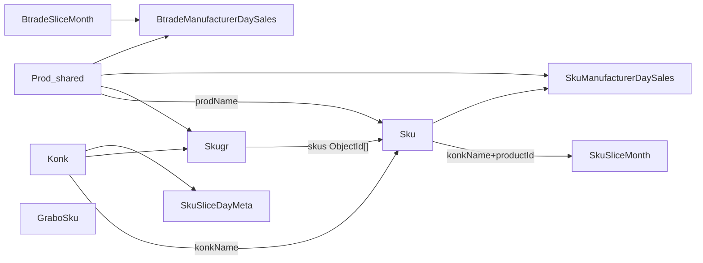

# Карта домена SKU-successor

## Сущности и связи

- **Konk** — справочник конкурента (`name` = ключ в Sku/Skugr).
- **Prod** — справочник производителя; **общий** со складом.
- **Sku** — карточка товара конкурента; связь с группами только со стороны Skugr.
- **Skugr** — группа листинга конкурента+производителя с массивом `_id` Sku.
- **SkuSliceMonth** — source of truth точек stock/price по дням месяца.
- **SkuSliceDayMeta** — observability дневного прогона среза (без точек).
- **SkuSlice** (`sku_slices`) — legacy Mixed; runtime stock не пишет; migrate/verify.
- **SkuManufacturerDaySales** — дневной rollup продаж конкурента по prodName.
- **Btrade** в successor воспринимается как **конкурент**: срезы `BtradeSliceMonth` (+ legacy `BtradeSlice`), rollup `BtradeManufacturerDaySales`; scrapers/парсинг — отдельный competitor-модуль.
- **GraboSku** — каталог производителя Grabo; **не конкурент**, отдельный модуль-директория.

Auth: **User**, **Role** — как в старом проекте.

## Периметр

### Внутри successor

| Область               | Смысл                                                                                      |
| --------------------- | ------------------------------------------------------------------------------------------ |
| skus / skugrs / konks | карточки, группы, справочник конкурентов                                                   |
| prods                 | shared справочник производителей                                                           |
| slices + reporting    | срезы, materialize, агрегаты продаж/графиков                                               |
| competitors/*         | scrapers/парсеры: air, balun, yumi, yumin, sharte, perfect, svbum, dojdevik, **btrade**, … |
| grabo                 | каталог Grabo, sync, UI/export needs                                                       |
| excel                 | новый пайплайн экспортов под SKU/grabo/btrade-сравнения                                    |
| auth                  | JWT/roles v1 = старый контракт пользователей                                               |

### Вне периметра

- **analogs / analog-slices** и analog-часть compensating cron — складской мир.
- Склад: arts, poses, pallets, asks, zones, rows, defs, …
- Публичные browser demo-роуты текущего Express.

## Зарезервированные доменные ключи

- `prodName: newsku` — временный производитель «Новинок» до классификации.
- `productId` — канон `{konkLower}-{rawId}`.
- `konk=all` в catalog excel — все конкуренты (поведение референса; в новом excel — своя реализация).

## Текущие vs целевые «модули»

В `btw-wh-server` SKU размазан по Express-модулям (`skus`, `skugrs`, `sku-slices`, `sku-reporting`, `sku-sales-reports`, `sku-chart-reports`, `sku-excel-reports`, `excel-jobs`, `browser`, `btrade-slices`, `grabo-skus`, …).

В successor границы — **директории** по [TARGET_LAYOUT.md](./TARGET_LAYOUT.md); HTTP-пути старого API копировать не обязательно.
